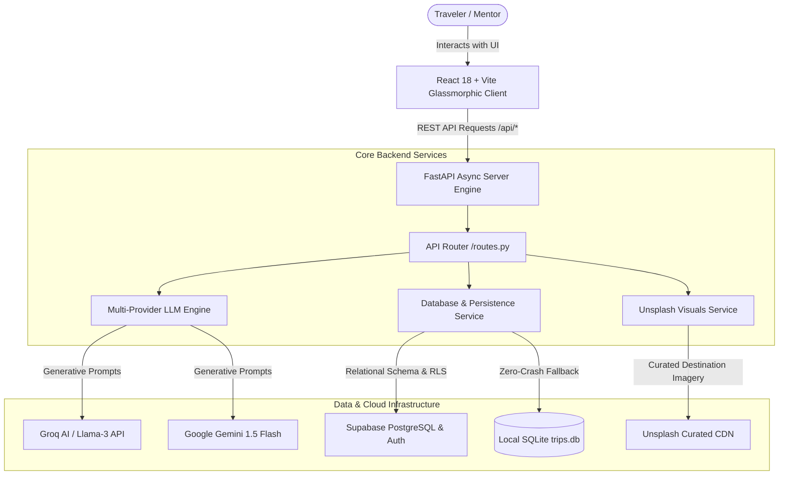

# ✈️ VoyageCraft AI — Personalized Travel Itinerary Planner
> **Full-Stack AI-Powered Travel Architecture, Dynamic Day Scheduling & Algorithmic Budget Optimization**

[](https://www.python.org/)
[](https://fastapi.tiangolo.com/)
[](https://react.dev/)
[](https://vitejs.dev/)
[]()
[](https://opensource.org/licenses/MIT)

---

## 🌟 Executive Summary

**VoyageCraft AI** is an enterprise-grade, full-stack travel planner designed to eliminate travel decision fatigue. Powered by **Generative AI** and prompt engineering best practices (the **Golden Prompt Formula**), the platform synthesizes realistic, geographically clustered, day-by-day travel itineraries with granular budget calculations, meal recommendations, transit guidance, and dynamic packing checklists.

Built to fulfill the **SkillWallet / FutureSkills Prime** capstone specifications across **Solo**, **Couple**, and **Small Group** travel personas.

---

## 🏛️ System Architecture



### Technology Stack
* **Frontend**: React 18, Vite, Vanilla CSS with custom HSL design tokens, Glassmorphism panels, and Lucide icons.
* **Backend**: FastAPI (Python), Pydantic v2 schemas, Starlette, Uvicorn ASGI server.
* **Generative AI**: Multi-provider engine (Groq Cloud Llama-3 / Google Gemini 1.5 Flash / Domain Knowledge Synthesis Engine).
* **Database & Persistence**: Supabase PostgreSQL with Row Level Security (RLS) policies + thread-safe local SQLite fallback for 100% offline reliability.
* **Image Delivery**: Unsplash CDN integration with high-definition destination photography.

---

## 🎯 Evaluated Scenarios (SkillWallet Benchmark)

The application includes 1-click preset execution for all course-evaluated scenarios:

| Scenario | Persona | Target Destination | Duration | Budget Tier | Travel Style | Key Characteristics |
| :--- | :--- | :--- | :---: | :---: | :---: | :--- |
| **Scenario 1** | **Solo Traveler** | Kyoto, Japan | 3 Days | Budget ($) | Cultural & Historical | Time-optimized temple hikes, authentic street ramen, low-friction transit. |
| **Scenario 2** | **Couple** | Santorini, Greece | 4 Days | Luxury ($$$) | Romantic Getaway | Caldera cliff hikes, sunset terrace dining, wine tasting, relaxed luxury pacing. |
| **Scenario 3** | **Small Group** | Tokyo, Japan | 5 Days | Moderate ($$) | Culinary & Foodie | Balanced group pacing, retro arcades, teamLab digital art, evening izakayas. |

---

## 🚀 Quickstart & Installation

### Prerequisites
* Python 3.10 or higher
* Node.js 18+ and npm

### 1. Clone & Set Up Backend
```bash
# Navigate to the backend directory
cd ai-travel-itinerary-planner/backend

# Install Python dependencies
pip install -r requirements.txt

# Run backend tests
python -m pytest tests/test_planner.py -v

# Start the FastAPI server (runs on http://localhost:8000)
python run_server.py
```

### 2. Set Up Frontend (Development Mode)
```bash
# Open a new terminal and navigate to frontend directory
cd ai-travel-itinerary-planner/frontend

# Install dependencies
npm install

# Start Vite live development server (runs on http://localhost:5173)
npm run dev
```

### 3. Unified Production Mode (1-Command Run)
The frontend build is compiled directly into `frontend/dist`. Running the FastAPI backend will automatically serve both the REST API and the static React web application on **`http://localhost:8000`**:
```bash
cd ai-travel-itinerary-planner/backend
python run_server.py
```
Open **`http://localhost:8000`** in any web browser!

---

## 📡 REST API Documentation

Interactive Swagger OpenAPI docs are available at **`http://localhost:8000/docs`**.

| Method | Endpoint | Description |
| :--- | :--- | :--- |
| `GET` | `/api/health` | Health check & subsystem availability probe |
| `GET` | `/api/scenarios` | Lists the 3 pre-configured course benchmark scenarios |
| `POST` | `/api/generate` | Synthesizes a new customized day-by-day travel itinerary |
| `POST` | `/api/trips` | Saves an itinerary to the persistent database |
| `GET` | `/api/trips` | Lists all saved itineraries with summary metadata |
| `GET` | `/api/trips/{trip_id}` | Retrieves full day-by-day itinerary details by ID |
| `DELETE` | `/api/trips/{trip_id}` | Deletes a saved itinerary |
| `PATCH` | `/api/trips/{trip_id}/activities/{activity_id}` | Toggles activity completion status interactively |
| `GET` | `/api/export/{trip_id}/json` | Exports the full itinerary as structured JSON |

---

## 💾 Database Schema (Supabase & PostgreSQL)

The production database schema is provided in [`database/schema.sql`](database/schema.sql). It features:
* `trips`: Stores core trip metadata, persona configurations, and full JSON payload.
* `trip_days`: Normalized table for day numbers, themes, and daily budgets.
* `trip_activities`: Normalized table for activity time slots, costs, and completion status.
* **Row Level Security (RLS)**: Secures user trips with configurable policies.
* **B-Tree Indexes**: Placed on `user_id`, `destination`, and `created_at` for sub-millisecond retrieval.

---

## 🧪 Test Verification Suite

All unit and integration tests run against FastAPI's TestClient:
```bash
python -m pytest backend/tests/test_planner.py -v
```

```text
============================= test session starts =============================
backend/tests/test_planner.py::test_health_endpoint PASSED               [ 16%]
backend/tests/test_planner.py::test_scenarios_listing PASSED             [ 33%]
backend/tests/test_planner.py::test_scenario_1_solo_traveler PASSED      [ 50%]
backend/tests/test_planner.py::test_scenario_2_couple_romantic PASSED    [ 66%]
backend/tests/test_planner.py::test_scenario_3_group_foodie PASSED       [ 83%]
backend/tests/test_planner.py::test_itinerary_persistence_and_interactive_toggle PASSED [100%]
======================== 6 passed in 0.57s =========================
```

---

## 📄 License
This project is open-source under the MIT License.
