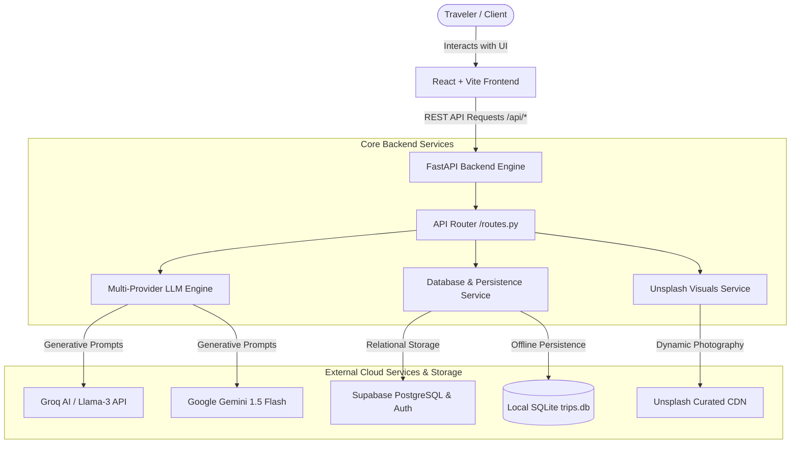

# Technical Architecture & System Design
## AI-Powered Personalized Travel Itinerary Planner

### 1. High-Level Architecture Overview

The **Personalized Travel Itinerary Planner** is structured following modern multi-tier cloud-native paradigms, combining a responsive **React 18 (Vite)** client, an asynchronous **FastAPI** backend, and a hybrid database layer (PostgreSQL / Supabase with local SQLite fallback for complete offline resilience).

---

### 2. The 3 Evaluated Travel Scenarios

| Scenario | Target Persona | Destination | Duration | Budget Tier | Travel Style | Key Characteristics |
| :--- | :--- | :--- | :---: | :---: | :---: | :--- |
| **Scenario 1** | **Solo Traveler** | Kyoto, Japan | 3 Days | Budget | Cultural & Historical | Time-optimized temple hikes, authentic street ramen, low-friction public transit. |
| **Scenario 2** | **Couple** | Santorini, Greece | 4 Days | Luxury | Romantic Getaway | Caldera cliff hikes, sunset terrace dining, wine tasting, relaxed luxury pacing. |
| **Scenario 3** | **Small Group** | Tokyo, Japan | 5 Days | Moderate | Culinary & Foodie | Balanced group pacing, retro arcades, teamLab art, evening izakayas. |

---

### 3. Prompt Engineering: The Golden Prompt Formula

The core generation pipeline uses structured prompt templates to guarantee strict JSON schemas:
- **[Role]**: World-Class Principal Travel Architect & AI Itinerary Specialist.
- **[Context]**: Destination, travel dates, budget tier, travel style, group size, and dietary restrictions.
- **[Rules]**: Geographic clustering to avoid commute fatigue, authentic breakfast/lunch/dinner venues, realistic itemized pricing, and zero conversational filler.
- **[Output]**: Strongly typed Pydantic JSON payload.

---

### 4. Interactive State & Persistence

- **Activity Tracking**: Users can interactively check off visited landmarks. State is synced asynchronously via `PATCH /api/trips/{trip_id}/activities/{activity_id}`.
- **Normalized Budget Analytics**: Costs are broken down into Accommodation, Dining, Sightseeing, Transit, and a 10% Contingency Buffer, calculated per trip and per person.
- **Exporting**: Instant export to print-ready PDF via `window.print()` and structured machine-readable JSON files.
